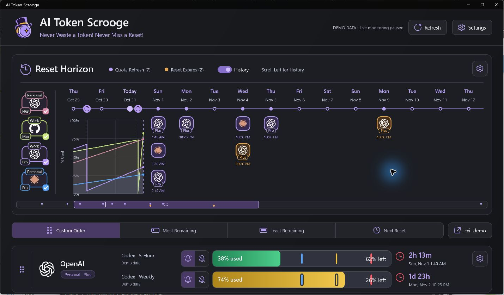
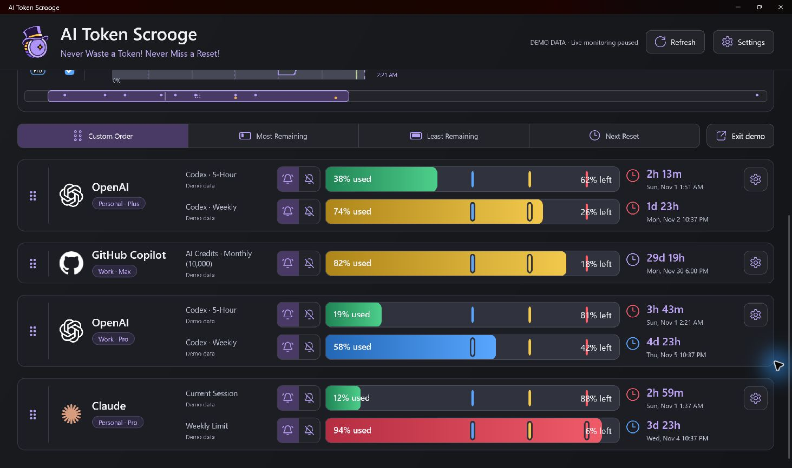
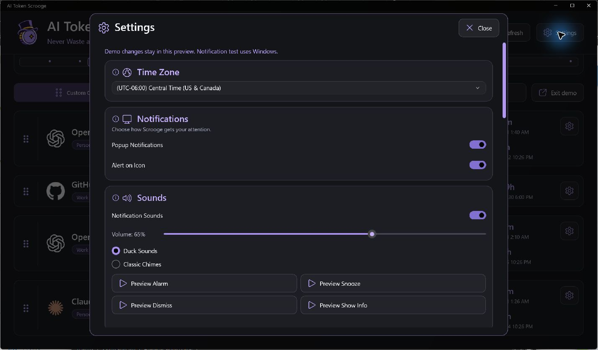

<p align="center">

  

</p>

# AI Token Scrooge

**Never Waste a Token! Never Miss a Reset!**

Ever let an earned Codex reset expire before you could use it? Or realized you could have run that longer agent task before your allowance refreshed? Me too. That's why I built AI Token Scrooge.

You're paying for that AI capacity. Scrooge helps you see what's left and when it's coming back, so you can put it to work.

Built for Windows with .NET 10 MAUI and the Windows App SDK, Scrooge brings your AI usage into a native desktop app with Windows notifications and system tray monitoring.

[Features](#what-scrooge-does) · [Providers](#supported-providers) · [Getting Started](#getting-started) · [Build from Source](#build-and-run-from-source) · [Future Tasks](#future-tasks)



## What Scrooge Does

- See what's coming with Reset Horizon. Your usage history, upcoming refreshes, and earned Codex reset expirations share one timeline. Spot a refresh coming up and decide whether it's time to tackle that bigger task.
- Find the account with room to work. See usage bars and reset countdowns for Codex, Copilot, and Claude together, with automatic checks at your chosen polling intervals.
- Use those earned resets before they expire. Get a reminder while there's still time to claim them in Codex. Scrooge keeps track; you decide when to use them.
- Know when you're running low and when you're ready to go again. Get alerts as capacity runs down or becomes available, with sounds, quiet hours, snoozing, and mute controls that fit your day.
- Let Scrooge keep watch while you work. Start it with Windows and leave it in the system tray. Your dashboard is one click away.

Checking usage does not consume AI tokens. Scrooge monitors and reminds you; it doesn't send AI prompts, claim resets, purchase credits, or switch accounts in your other apps.

**Never Waste a Token! Never Miss a Reset!**

## Supported Providers

<table>
<thead>
<tr><th width="15%">Provider</th><th width="35%">What Scrooge Shows</th><th width="50%">Connection and Limits</th></tr>
</thead>
<tbody>
<tr>
<td>OpenAI Codex</td>
<td><ul><li>Provider-Reported Usage Windows</li><li>Remaining Capacity</li><li>Reset Times</li><li>Available Earned Resets, When Supplied</li></ul></td>
<td>Requires the installed Codex CLI. Scrooge uses it to open browser sign-in with your ChatGPT account and read your Codex usage limits and reset times. Checking usage does not consume AI tokens.</td>
</tr>
<tr>
<td>GitHub Copilot</td>
<td><ul><li>Monthly AI-Credit and Premium-Request Usage</li><li>Allowance, When Available</li><li>Remaining Percentage</li><li>Monthly Refresh</li></ul></td>
<td>Sign in through GitHub's website using a short authorization code. Scrooge reads Copilot AI-credit and premium-request usage through GitHub's official billing API and uses an internal GitHub endpoint to detect your plan's allowance when available. No installed GitHub CLI is required. Checking usage does not consume AI tokens.</td>
</tr>
<tr>
<td>Claude</td>
<td><ul><li>Session Usage Windows (Pro/Max)</li><li>Weekly Usage Windows (Pro/Max)</li></ul></td>
<td>Requires the installed Claude CLI (Claude Code) version 2.1.310 or later. Scrooge uses it to open browser sign-in and read usage, with a separate profile for each account. Checking usage does not consume AI tokens.</td>
</tr>
</tbody>
</table>

## Reading the Dashboard



An account can have more than one limit. Your session allowance might refill tonight while the weekly allowance stays nearly empty until Thursday. Each row has its own countdown and alert controls for that reason.

| Visual | Meaning |
| --- | --- |
| Used / Left Percentages | How much of that particular allowance has been consumed and remains |
| Green, Blue, Yellow, and Red Bar States | Normal capacity, informational threshold, warning, and critical capacity |
| Colored Threshold Handles | Info, warning, and critical levels based on percentage remaining; drag them to adjust that row |
| Bell Controls | Enable or mute alerts for the individual quota row |
| Countdown and Date | The next reported refresh time for that quota window |
| Account Gear | Rename, adjust polling, choose a history-line color, pause monitoring, manage alerts, reconnect, or remove the connection |

Click a usage bar for details. Sort by Most Remaining, Least Remaining, or Next Reset to find the account you need. For a fixed order, choose Custom Order and drag the account handles.

### Reset Horizon and Usage History

Purple events mark quota refreshes, when an allowance is expected to refill. Amber events mark earned-reset expirations, when an unused reset credit will expire.

- Provider icons and plan badges identify each event. Hover or click for details.

- The checkable account icons on the left filter the timeline's usage lines and events.

- The History toggle shows or hides historical usage content. With history off, navigation begins at Today.

- The navigator at the bottom moves through the date range, including historical usage when enabled.

- Give each account a different line color to make its history easier to follow.

- Scrooge keeps history and alerts for 90 days by default. Customize the retention period in Settings.

## Notifications and Settings



| Control | What It Does |
| --- | --- |
| Popup Notifications / Alert on Icon | Choose Windows popup delivery and app-icon alert status |
| Default Alert Levels | Set informational, warning, and critical percentages of capacity remaining |
| Capacity Exhausted | Alert when a limit reaches no remaining capacity, with its dashboard alarm enabled |
| Capacity Restored | Alert after an exhausted limit has capacity again and the provider confirms usage is allowed |
| Earned Reset Expiration Alerts | Configure lead times and severities before unused earned resets expire |
| Quota Refresh Alerts | Configure a separate schedule before quota refreshes |
| Quiet Hours | Quiet notification delivery during a chosen time range, including overnight ranges, while monitoring continues |
| Sounds | Choose Duck Sounds or Classic Chimes, adjust volume, and preview notification actions |
| Alert History / Snooze | Review recorded alerts and postpone eligible notifications |
| Time Zone | Control displayed dates, reset times, and quiet-hour interpretation |

Choose how often to check each account with the Polling Interval slider: 1 to 30 minutes, starting at 2 minutes by default. A shorter interval catches changes sooner.

## Getting Started

1. Download the Windows preview ZIP from [Releases](https://github.com/lancelarsen/AI-Token-Scrooge/releases), or follow the build instructions below.

2. Extract the entire portable package to a stable folder and run `AIResetRadar.App.exe`.

3. Select Add Account and choose a provider. Complete the provider's sign-in in your browser.

4. Review the detected usage windows, then choose your alert thresholds and notification preferences.

5. Leave Scrooge running in the tray if you want background monitoring. Use Exit Scrooge in the tray menu to stop it.

- Add your first account when you launch Scrooge, then connect any additional accounts you want to monitor.
- For OpenAI Codex, install the Codex CLI and sign in with your ChatGPT account through the browser.
- For Claude, install Claude Code version 2.1.310 or later. Scrooge uses that CLI to open browser sign-in and read usage.
- For GitHub Copilot, approve the short authorization code on GitHub's website. No GitHub CLI is needed. The authorization screen currently shows AI Reset Radar, the app's registered name.
- If you build your own copy, configure the GitHub app registration using [GitHub Sign-In Setup](docs/github-sign-in.md).

## Build and Run from Source

Build on Windows. If you just want to use Scrooge, download the portable package from Releases instead.

1. Install Git and the .NET SDK version listed in `global.json` (currently 10.0.403).
2. Open PowerShell and download the source:

   ```powershell
   git clone https://github.com/lancelarsen/AI-Token-Scrooge.git
   cd AI-Token-Scrooge
   ```

3. Install the Windows MAUI tools:

   ```powershell
   dotnet workload install maui-windows
   ```

4. Build a portable copy:

   ```powershell
   dotnet publish src/AIResetRadar.App/AIResetRadar.App.csproj -c Release -r win-x64 --self-contained true -p:WindowsAppSDKSelfContained=true -o artifacts/publish/win-x64
   ```

5. Open `artifacts/publish/win-x64` and run `AIResetRadar.App.exe`. Keep the entire folder together when moving the app.

## Contributions Welcome

Want to help Scrooge keep track of more of your AI tools? We'd love contributions for Grok and other services, along with bug fixes.

Start with [Contributing](CONTRIBUTING.md) and the [Contribution Roadmap](tasks/contributor-roadmap.md). Our [Design Guidelines](docs/design.md), [Application Architecture](docs/architecture.md), and [Provider Integration Guide](docs/integration.md) explain how additions should fit the app.

## Future Tasks

- [ ] Research and integrate additional providers, including Grok, Gemini, Cursor, and Windsurf, where a reliable usage source is available
- [ ] Provide a signed Windows installer
- [ ] Complete broader live-provider testing, including reconnecting and removing accounts

Found a problem? Open a [GitHub Issue](https://github.com/lancelarsen/AI-Token-Scrooge/issues) with your app version, provider, steps to reproduce, and a screenshot with private information removed.
