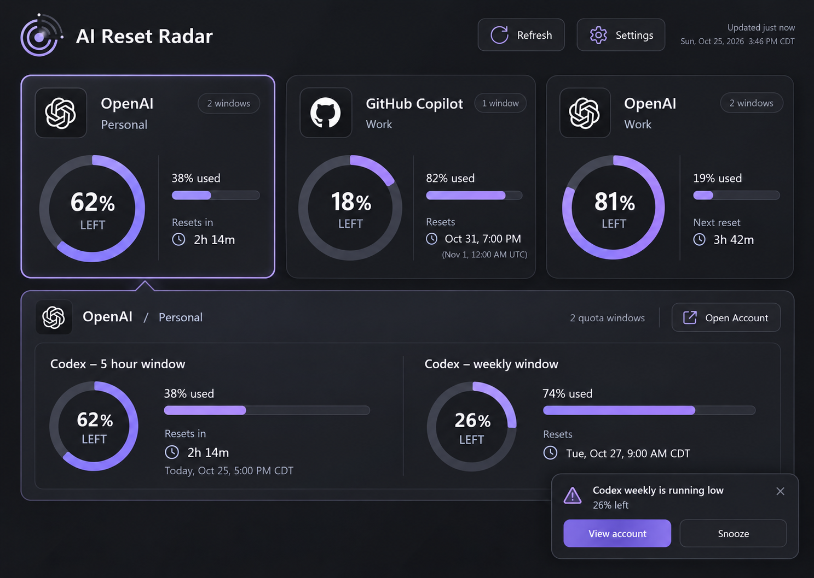
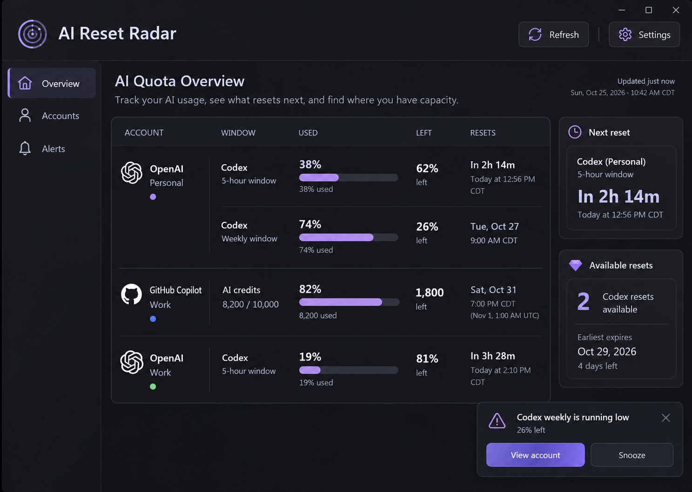
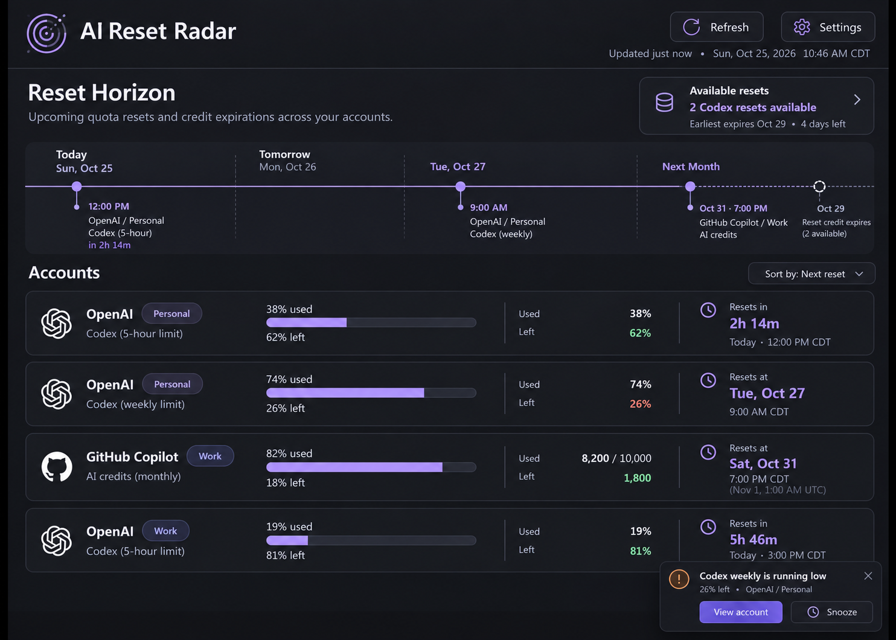
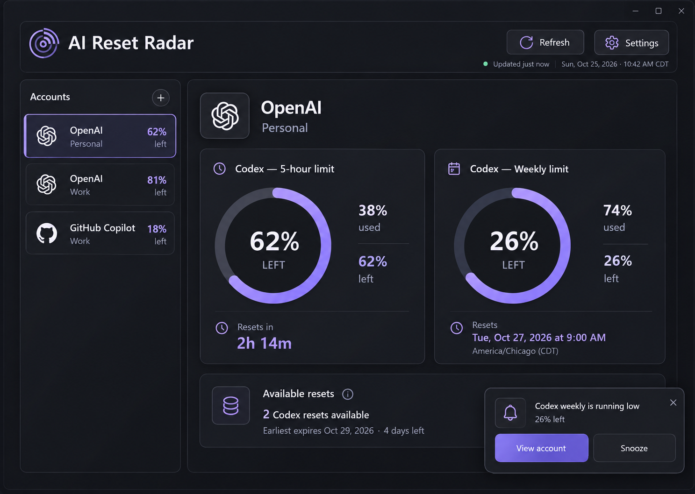
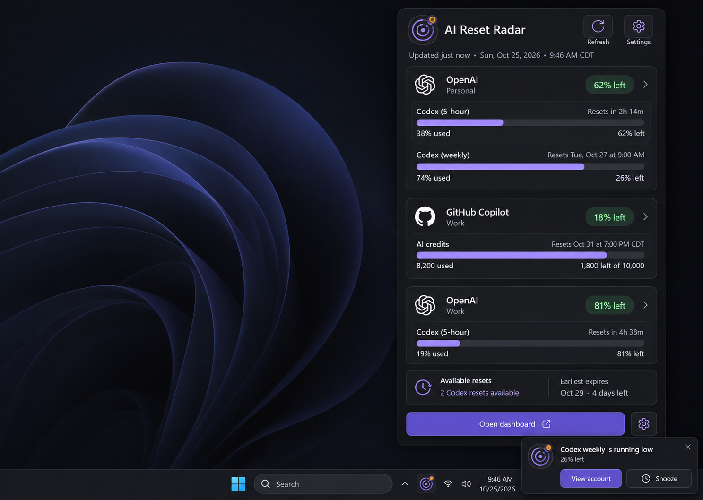
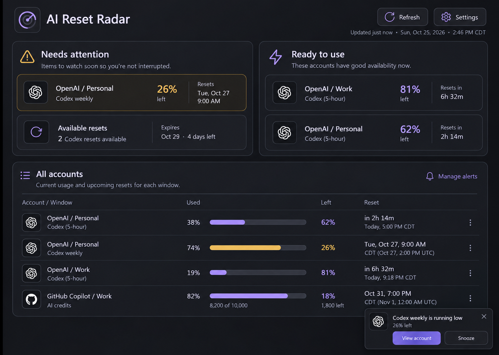
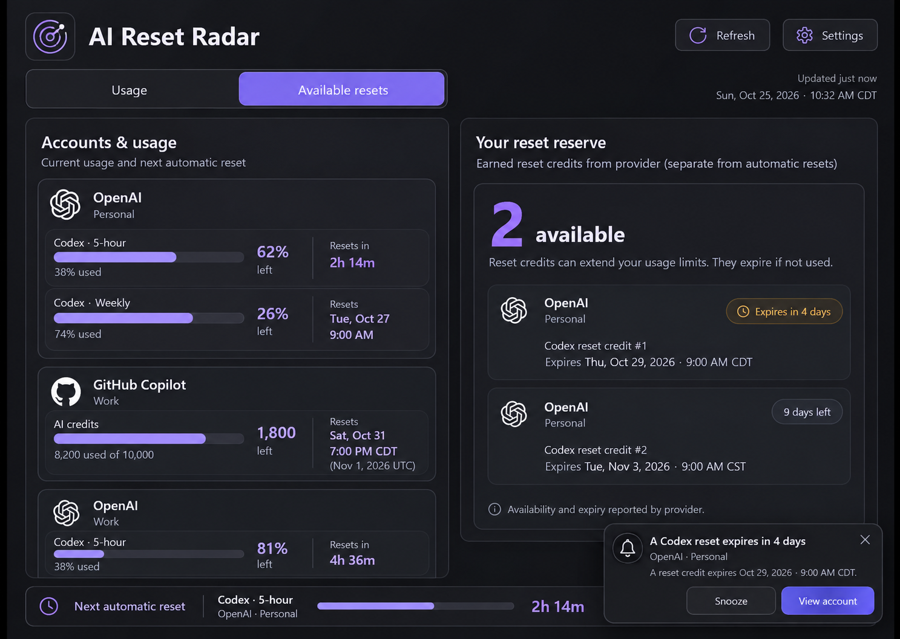
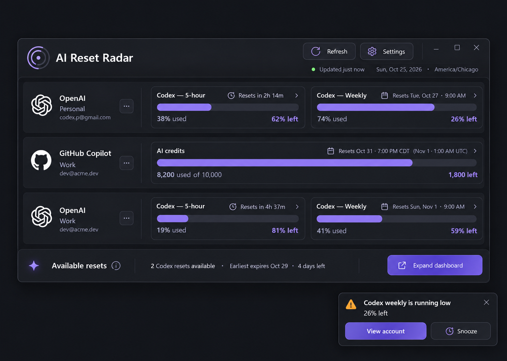

# AI Reset Radar — eight dark Windows UI concepts

Created October 25, 2026 with the built-in ImageGen tool. Each image is an independent generation with the actual Creator Micro editor screenshot attached. Display order in the chat is the numbering below. All figures, accounts and dates in the mockups are illustrative, not live telemetry.

The user selected image 3, Reset Horizon, as the base, then chose round 2 image 7, Quiet Warning, as the final visual target. See `D:/Dev/AI/AIResetRadar/design/selection.md` and `D:/Dev/AI/AIResetRadar/design/references/approved-ui.png`. These first-round images remain preserved as exploration history.

## 1 — Keycap Observatory

Tactile account tiles, remaining-capacity rings, and a selected-account detail panel. Closest to the source app's dimensional keycap feel.

## 2 — Quiet Ledger

Grouped account/window rows emphasize exact Used / Left / Reset values, with next-reset and reserve summaries beside them.

## 3 — Reset Horizon

A timeline puts upcoming automatic resets and expirations above the account usage list.

## 4 — Capacity Cockpit

An account switcher and large individual quota-window gauges emphasize one selected account.

## 5 — Tray Companion

A compact tray flyout provides a quick capacity check without opening the main dashboard.

## 6 — Attention Desk

Low capacity and expiring resets appear first, with available account capacity and a precise usage list nearby.

## 7 — Reset Reserve

An earned-reset view foregrounds available count and expiry while preserving account usage context.

## 8 — Studio Strip

A compact horizontal companion shows account lanes with usage bars and countdowns.

## Reference and generation record

- Reference editor: `references/creator-micro-editor.png`.
- Reference settings: `references/creator-micro-settings.png`.
- Complete prompts/tool/reference provenance: `concepts/prompts.json`.
- All eight final PNGs are saved in this workspace; originals remain in the tool's generated-images folder.

## Visual inspection notes

All eight images were opened in the tool results and checked for dark palette, source resemblance, materially distinct layout, account identity, visible used/left/reset information and popup treatment. They satisfy visual-exploration scope; they are not functional UI tests.

Artifact checks passed: exactly eight decodable PNGs, eight prompt records, eight gallery entries, and SHA-256 equality between every workspace copy and its generated original. Output sizes are 1487×1058 for seven images and 1484×1060 for the timeline study; 1440×1024 was the requested design viewport, not the tool's exact output resolution. No image was stretched to change that aspect ratio.

Do not copy generated data literally. Concept 3 places the Oct 29 expiry after Oct 31 on its decorative timeline; production events must be chronologically sorted. Concepts 2, 3 and 8 contain an incorrect parenthetical UTC label for the Copilot reset; **Oct 31, 2026 at 7 PM CDT is Nov 1 at 00:00 UTC**. Some examples invent inconsistent short-window countdowns; use provider timestamps rather than artwork labels. Concept 5 uses a healthy-looking green on the low Copilot remaining figure; production alert color must follow actual rules. Several headline account percentages show the selected short window rather than the account's most restrictive window; production must name that window or label a computed limiting-window summary. Generated popup overlap, extra borders and small text should be refined against the selected direction and native layout.

The product should preserve the selected round 2 design while obeying `../tasks/plan.md` for arithmetic, scope, freshness, expiry and alert semantics. The visual selection is complete.
