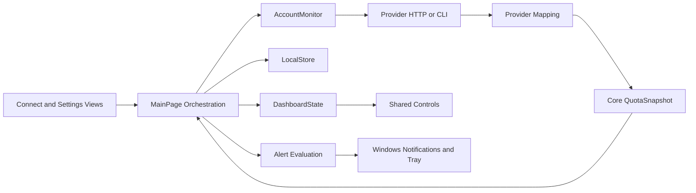

# Application Architecture

This guide describes the existing C#/.NET 10 MAUI Windows application. Product copy says AI Token Scrooge; solution, namespace, and data-folder names still use AIResetRadar. Do not rename persisted identifiers or namespaces as part of an unrelated contribution.

## Project Boundaries

| Project or Folder | Owns | Keep Out |
| --- | --- | --- |
| `src/AIResetRadar.Core` | Immutable account/quota records, arithmetic, identity policies, scheduling, alert rules, retention | MAUI, HTTP, processes, SQLite, Windows UI |
| `src/AIResetRadar.Infrastructure` | Provider transport, mapping, credentials, persistence | Dashboard layout and direct UI updates |
| `src/AIResetRadar.App` | Composition, orchestration, presentation, user interactions | Provider response parsing inside controls |
| `App/Platforms/Windows` | Tray, startup, notifications, native input/handlers | Portable quota arithmetic |
| `tests/AIResetRadar.Core.Tests` | Pure domain behavior | Real credentials or network requirements |
| `tests/AIResetRadar.Infrastructure.Tests` | Transport, persistence, selected presentation/orchestration source tests | Uncontrolled live-provider polling |
| `tools/AIResetRadar.Probe` | Focused diagnostic tooling | Automatic production dependency |

App references Core and Infrastructure. Infrastructure references Core. Core does not reference either outer layer. The app uses programmatic MAUI views, MainPage partial classes, and DashboardState; it is not currently organized around a generic MVVM framework or provider plug-in registry.

## Composition and Data Flow

[AppServices](../src/AIResetRadar.App/Services/AppServices.cs) composes LocalStore, AccountMonitor, GitHub device flow, the shared HTTP client, and the Windows secret store. Its data-directory override supports isolated development runs. [MauiProgram](../src/AIResetRadar.App/MauiProgram.cs) registers platform handlers.

Connection gathers identity and an initial snapshot before accepting an account. Refresh routes through AccountMonitor, verifies identity, maps provider data, and returns a normalized snapshot. Orchestration checks whether the result still belongs to the active connection before persisting or rendering it. Background completion must not resurrect a removed account or overwrite a newer connection.

## Domain Contracts

[Quota.cs](../src/AIResetRadar.Core/Quota.cs) defines the shared contract:

- ProviderAccount separates the local Id, provider Subject, billing/workspace Scope, and CredentialId. Nicknames are presentation, not identity.
- QuotaWindow has a stable Id, unit, nullable usage/limit, nullable reset time, duration, and allowance provenance. Preserve Percent, Credits, and Requests as distinct units.
- QuotaSnapshot carries observation time, optional provider-data time, health, optional usage permission, plan, windows, and a separate reset reserve.
- ResetReserve count and credit details are independent. A count may be known while expiration details are partial or unavailable.
- SourceHealth distinguishes loading, stale, offline, authentication, permissions, unsupported data, and demo state.

Keep unknown values nullable. Clamp visual fills, not raw accounting data. A negative absolute remaining balance can represent overage. A known plan name does not establish an allowance. Reuse BelongsTo, ScopeEquals, and ReconnectPolicy rather than comparing only nicknames or email display text.

Use UTC DateTimeOffset values for observations and boundaries, TimeProvider for testable time, and the configured TimeZones conversion for display. Tests must not assume the host's local zone. Calendar-day geometry and actual timestamps have different roles; follow [Design Guidelines](design.md#reset-horizon-invariants).

## Orchestration and Concurrency

MainPage is split by responsibility: Accounts manages acceptance, disabling, removal, cancellation, and retirement; Preferences serializes settings changes; History loads history; Alerts, AlertEvaluation, AlertHistory, and Snooze handle alert state; Desktop handles Windows lifecycle; Ordering and Thresholds handle direct manipulation.

Account mutation and credential cleanup have separate synchronization. Preserve cancellation and stale-result checks. Commit accepted account state before retiring old credentials. Cleanup can fail and must remain retryable across restarts. Disconnect only Scrooge-owned credentials and profiles.

LocalStore implements ICredentialLifecycleJournal. A new sign-in records its provider and fresh credential ID in `pending-credentials` before the CLI starts authentication or GitHub saves a secret. This record contains no token or account identity. Account acceptance clears its entry in the same SQLite transaction that saves the account and initial snapshot. Startup converts unfinished entries into the existing retirement queue, excluding credentials referenced by active accounts. Failed deletion or logout keeps cleanup retryable.

After successful CLI logout and process disposal, OwnedProfileDirectory removes only the selected GUID-named profile under Profiles or ClaudeProfiles. It checks containment, Windows ownership, and the entire tree for redirected paths before deletion. Read-only cache files are made writable only after the owned tree passes validation and the specific file is rechecked. Redirected paths and locked files leave cleanup pending. It does not sweep other profiles or claim provider-side revocation.

CliProfilePaths dispatches that filesystem work to a worker task and awaits it. A CLI profile can contain tens of thousands of cache files; validation and deletion must not run on the UI thread. Cancellation can prevent the worker from starting. Once it starts, its result is awaited, and successful removal completes the journal without the expired caller token. A filesystem or persistence failure still leaves cleanup retryable. Orchestration allows 90 seconds for provider cleanup, accommodating Codex initialization and logout with their existing 40-second request limits and Claude's 60-second command limit. The previous eight-second deadline canceled a live retired-profile retry. Fixture coverage verifies the deadline and retry behavior. One authorized live Codex retirement completed after this change; other provider lifecycle checks remain open. The provider-call deadline does not impose a hard deadline on filesystem cleanup already in progress.

Preference updates use a gate, persist before adopting the new in-memory state, and preserve unrelated per-window settings. Startup registration changes have rollback handling. A new setting must retain these behaviors and deserialize older saved settings with a deliberate default.

RefreshSchedule chooses the next normal poll or an earlier known future boundary. Provider retry deadlines and backoff must still be respected by orchestration. Do not add a second per-provider UI timer or poll directly from Render, a property getter, or a control.

## CLI Process Boundary

Codex and Claude launch from their existing installation locations with absolute executable paths and ArgumentList, without shell or PATH resolution. Codex discovery skips redirected subdirectories; both executable paths reject reparse points. These checks constrain file selection but do not authenticate a publisher. Signature validation of the installed binaries is recorded separately in the verification checkpoint.

CliEnvironment removes the listed provider credential/configuration prefixes, cloud credential selectors, and Node/Bun startup overrides before assigning the isolated CODEX_HOME or CLAUDE_CONFIG_DIR. Windows runtime and proxy settings remain available. This is an explicit filter, not a guarantee that arbitrary secret-bearing environment variables are removed. Process working directories remain the isolated profiles.

Claude commands use BoundedCliProcess: stdout and stderr each have a two-million-character limit, stderr is discarded, and non-login commands have a 60-second deadline. Browser login allows ten minutes and remains cancelable. Cancellation, output overflow, or deadline expiry requests termination of a still-running child process tree; the subsequent process-exit wait is limited to five seconds. Tests verify the directly launched process and an owned descendant while the parent remains running. Independently detached descendants and descendants whose parent has already exited remain unverified. Codex keeps its bounded protocol-line reader, discarded stderr stream, RPC allowlist, and per-request timeout. Neither transport falls back to inference when usage cannot be read.

## Persistence and Secrets

LocalStore owns a SQLite database containing JSON state and compacted history. Reads/writes use the store's gate; transactions keep related monitoring changes consistent. Schema upgrades use user_version and reject newer unsupported schemas. Do not call a gate-taking public store method recursively while already holding the gate.

History packing, definition reuse, range queries, and graph reduction live in the LocalStore history partials and App presentation helpers. See [History Storage](history-storage.md) before changing them. Current retention defaults to 90 days and reads the saved setting; older notes may describe the original 45-day policy. Increasing retention cannot recover deleted records.

SQLite history and settings remain unencrypted by design; secrets are separate. Credential storage follows the provider-supported mechanism with the strongest compatible Windows protection:

- **GitHub:** WindowsSecretStore implements ISecretStore with current-user DPAPI and validated credential IDs. GitHubCredentialManager owns token renewal and persistence. GitHub recommends platform-appropriate storage; DPAPI is our Windows implementation choice.
- **Codex:** CodexConnection explicitly requests `cli_auth_credentials_store="keyring"`. Credentials are owned by the CLI's OS store, while its CODEX_HOME profile is isolated. OpenAI documents that keyring mode fails if unavailable; `auto` permits plaintext fallback and must not replace this setting. Do not duplicate credentials into WindowsSecretStore merely to unify storage.
- **Claude:** ClaudeClient supplies an isolated CLAUDE_CONFIG_DIR. Anthropic documents a `.credentials.json` file there on Windows, protected by inherited file permissions. Scrooge currently adds no encryption. Do not assume the CLI can consume DPAPI blobs or that API-key helpers support subscription usage and renewal.

Local hardening changes introduce WindowsCredentialDirectory in Infrastructure. It rejects reparse-point paths and applies explicit permissions for the current Windows user and SYSTEM. WindowsSecretStore uses it alongside bounded reads, per-path in-process gates, OS file leases, and encrypted temporary writes. Empty lease files remain in place so their removal cannot split the lock between processes. CodexConnection applies the directory policy before startup; ClaudeClient also restricts an existing `.credentials.json` before and after CLI execution. These source changes still require CLI lifecycle, cross-user, and release verification. They do not encrypt Claude's file or establish protection against an administrator.

AppServices composes WindowsMigratingSecretStore for GitHub. Its destination is `%LOCALAPPDATA%\AIResetRadar\Security\<data-directory-id>\Credentials`; the namespace is derived from the Windows volume and directory file identity. Different names for the same directory share credentials; separate data directories remain isolated. A custom database directory does not redirect this destination. Copying data to a different directory creates a different namespace and needs explicit migration or reconnect handling.

The migration wrapper leases each storage operation, reads an existing destination first, and otherwise saves and reads back a DPAPI-protected copy of the legacy record. Only then does it delete the old copy. Failed cleanup retries on later operations. A corrupt destination requires reconnect rather than falling back to a potentially stale legacy token. Removal deletes the legacy record first to prevent its later reimport.

GitHubCredentialManager also holds ISecretStore.AcquireOperationAsync across the complete read/renew/verify/save sequence and across credential removal. Windows stores implement this with a separate OS file lease shared by store instances and processes; storage and migration leases remain nested underneath it. The default interface implementation coordinates in-memory fixtures only. Any new persistent store must provide a lease shared by every process that can modify its credentials.

Before remote renewal, the manager persists a renewal-started marker. If saving a returned replacement fails, an in-memory retry may write it only while the saved record still matches that marker or the same replacement. A removed or newer credential invalidates the retry, preventing an older process from restoring it. A crash without a durable replacement requires reconnect instead of retrying a potentially consumed refresh token.

New Codex and Claude sign-ins use Profiles or ClaudeProfiles beneath the local Security namespace. ProviderAccount.ProfileLocation and the unfinished-sign-in journal store an explicit location enum, not an arbitrary path. Missing fields in old records mean LegacyDataDirectory, preserving the original keyring lookup and profile files. Refresh, cancellation, retirement, and cleanup use the saved location; they never guess from whichever folder exists. A missing local-root configuration fails rather than falling back to the database directory.

Staging or accepting a local-security profile raises SQLite user_version to 4 in the same transaction. Older executables reject this version instead of dropping a location field they do not understand. Acceptance also checks that its provider and location match the pending credential. Reconnect accepts a fresh credential/location only after identity checks and database commit; the old account retains its own location in the retirement queue.

Migration of existing CLI profiles remains open in the [Credential Protection Plan](../tasks/credential-protection-plan.md). Existing profiles are not moved automatically. Profile movement must preserve CLI credential lookup and account isolation rather than assuming directory moves are transparent to a keyring. See [Storage Decisions](decisions/credential-storage.md) and the [Verification Checkpoint](credential-protection-verification.md).

For that migration, App owns root selection and coordination with active account operations; Infrastructure owns path validation, permissions, secret I/O, and CLI compatibility. Core must remain independent of Windows credential APIs. Persist a verified destination reference before retiring an old owned copy, keep cleanup retryable, and never store token contents in migration state. Review interactions between separate app processes and databases; an in-process gate alone cannot coordinate them.

Never serialize tokens, auth.json contents, raw provider responses, or CLI stderr into state, logs, fixtures, or screenshots. Retain persist-before-retire ordering and distinguish local cleanup from provider revocation. The app's read-only operations do not reduce the permissions of a stolen token.

GitHubDeviceFlow remains the production sign-in transport. The plan separately reviews authorization code with PKCE against GitHub's current desktop/public-client guidance; no PKCE migration has been implemented. Optional Claude encryption also remains research. See [Security](../SECURITY.md#official-references) for official sources and the distinction between documented behavior and runtime verification.

## Rendering and Windows Lifecycle

App updates use BuildVersion and UpdateSchedule in Core, GitHubUpdates/UpdatePackage/UpdateInstallation in Infrastructure, and AppUpdateService plus the Settings card in App. The standalone Launcher owns the process handoff and active-version pointer. It has no database or credential dependency. Update-check metadata uses its own LocalStore key so it cannot overwrite global settings. See [App Versions and Updates](app-updates.md) for the layout, trust boundary, and acceptance checks.

DashboardState produces ordered account/window data, events, and render signatures. Preserve stable controls during timestamp-only updates so polling does not interrupt dragging, focus, or scrolling. UI work belongs on the dispatcher; provider and database work must not block it.

Platforms/Windows owns native services and handlers. Keep close-to-tray distinct from Exit Scrooge. Notification activation, single-instance routing, tray restoration, and startup recovery are lifecycle behaviors requiring native tests, not just unit tests.

Demo mode supplies synthetic observations and does not persist account/settings edits. Notification preview is a real Windows action. Never treat a successful demo as proof of provider access.

## Extending the Architecture

For a new provider, follow [Provider Integration](integration.md). Refresh and disconnect reject unknown providers. Add explicit routes and a validated lifecycle-journal provider entry; do not let an unknown provider fall through to Codex.

Keep shared behavior in Core or existing helpers when it is actually shared. A provider registry or interface can be proposed as a focused refactor with compatibility tests; do not document or depend on an abstraction that does not exist yet. Record substantial architecture changes in a short decision note under `docs/decisions/`, including the problem, chosen boundary, alternatives, migration, and verification.

See [Testing and Verification](testing.md) for the acceptance matrix and [Contributing](../CONTRIBUTING.md) for PR expectations.
