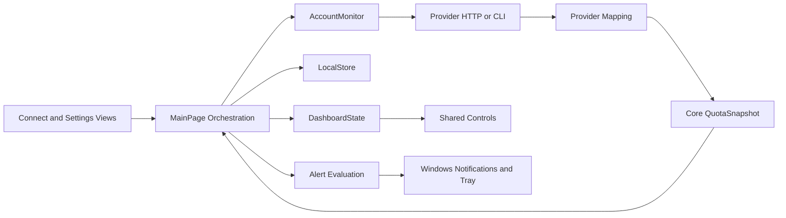

# Application Architecture

This guide describes the existing C#/.NET 10 MAUI Windows application. Product copy says AI Token Scrooge; solution, namespace, and data-folder names still use AIResetRadar. Do not rename persisted identifiers or namespaces as part of an unrelated contribution.

## Project Boundaries

| Project or Folder | Owns | Keep Out |
| --- | --- | --- |
| `src/AIResetRadar.Core` | Immutable account/quota records, arithmetic, identity policies, scheduling, alert rules, retention | MAUI, HTTP, processes, SQLite, Windows UI |
| `src/AIResetRadar.Infrastructure` | Provider transport, mapping, credentials, persistence | Dashboard layout and direct UI updates |
| `src/AIResetRadar.App` | Composition, orchestration, presentation, user interactions | Provider response parsing inside controls |
| `App/Platforms/Windows` | Tray, startup, notifications, native input/handlers | Portable quota arithmetic |
| `tests/AIResetRadar.Core.Tests` | Pure domain behavior | Real credentials or network requirements |
| `tests/AIResetRadar.Infrastructure.Tests` | Transport, persistence, selected presentation/orchestration source tests | Uncontrolled live-provider polling |
| `tools/AIResetRadar.Probe` | Focused diagnostic tooling | Automatic production dependency |

App references Core and Infrastructure. Infrastructure references Core. Core does not reference either outer layer. The app uses programmatic MAUI views, MainPage partial classes, and DashboardState; it is not currently organized around a generic MVVM framework or provider plug-in registry.

## Composition and Data Flow

[AppServices](../src/AIResetRadar.App/Services/AppServices.cs) composes LocalStore, AccountMonitor, GitHub device flow, the shared HTTP client, and the Windows secret store. Its data-directory override supports isolated development runs. [MauiProgram](../src/AIResetRadar.App/MauiProgram.cs) registers platform handlers.

Connection gathers identity and an initial snapshot before accepting an account. Refresh routes through AccountMonitor, verifies identity, maps provider data, and returns a normalized snapshot. Orchestration checks whether the result still belongs to the active connection before persisting or rendering it. Background completion must not resurrect a removed account or overwrite a newer connection.

## Domain Contracts

[Quota.cs](../src/AIResetRadar.Core/Quota.cs) defines the shared contract:

- ProviderAccount separates the local Id, provider Subject, billing/workspace Scope, and CredentialId. Nicknames are presentation, not identity.
- QuotaWindow has a stable Id, unit, nullable usage/limit, nullable reset time, duration, and allowance provenance. Preserve Percent, Credits, and Requests as distinct units.
- QuotaSnapshot carries observation time, optional provider-data time, health, optional usage permission, plan, windows, and a separate reset reserve.
- ResetReserve count and credit details are independent. A count may be known while expiration details are partial or unavailable.
- SourceHealth distinguishes loading, stale, offline, authentication, permissions, unsupported data, and demo state.

Keep unknown values nullable. Clamp visual fills, not raw accounting data. A negative absolute remaining balance can represent overage. A known plan name does not establish an allowance. Reuse BelongsTo, ScopeEquals, and ReconnectPolicy rather than comparing only nicknames or email display text.

Use UTC DateTimeOffset values for observations and boundaries, TimeProvider for testable time, and the configured TimeZones conversion for display. Tests must not assume the host's local zone. Calendar-day geometry and actual timestamps have different roles; follow [Design Guidelines](design.md#reset-horizon-invariants).

## Orchestration and Concurrency

MainPage is split by responsibility: Accounts manages acceptance, disabling, removal, cancellation, and retirement; Preferences serializes settings changes; History loads history; Alerts, AlertEvaluation, AlertHistory, and Snooze handle alert state; Desktop handles Windows lifecycle; Ordering and Thresholds handle direct manipulation.

Account mutation and credential cleanup have separate synchronization. Preserve cancellation and stale-result checks. Commit accepted account state before retiring old credentials. Cleanup can fail and must remain retryable across restarts. Disconnect only Scrooge-owned credentials and profiles.

Preference updates use a gate, persist before adopting the new in-memory state, and preserve unrelated per-window settings. Startup registration changes have rollback handling. A new setting must retain these behaviors and deserialize older saved settings with a deliberate default.

RefreshSchedule chooses the next normal poll or an earlier known future boundary. Provider retry deadlines and backoff must still be respected by orchestration. Do not add a second per-provider UI timer or poll directly from Render, a property getter, or a control.

## Persistence and Secrets

LocalStore owns a SQLite database containing JSON state and compacted history. Reads/writes use the store's gate; transactions keep related monitoring changes consistent. Schema upgrades use user_version and reject newer unsupported schemas. Do not call a gate-taking public store method recursively while already holding the gate.

History packing, definition reuse, range queries, and graph reduction live in the LocalStore history partials and App presentation helpers. See [History Storage](history-storage.md) before changing them. Current retention defaults to 90 days and reads the saved setting; older notes may describe the original 45-day policy. Increasing retention cannot recover deleted records.

Secrets are separate from SQLite. WindowsSecretStore uses current-user DPAPI and validated credential IDs. CLI credentials remain in isolated app-owned profiles. Never serialize tokens, auth.json contents, raw provider responses, or CLI stderr into state, logs, fixtures, or screenshots.

## Rendering and Windows Lifecycle

DashboardState produces ordered account/window data, events, and render signatures. Preserve stable controls during timestamp-only updates so polling does not interrupt dragging, focus, or scrolling. UI work belongs on the dispatcher; provider and database work must not block it.

Platforms/Windows owns native services and handlers. Keep close-to-tray distinct from Exit Scrooge. Notification activation, single-instance routing, tray restoration, and startup recovery are lifecycle behaviors requiring native tests, not just unit tests.

Demo mode supplies synthetic observations and does not persist account/settings edits. Notification preview is a real Windows action. Never treat a successful demo as proof of provider access.

## Extending the Architecture

For a new provider, follow [Provider Integration](integration.md). The current dispatch has explicit Claude/GitHub branches and a Codex fallback: new providers must be routed explicitly for refresh and disconnect. Do not let an unknown provider fall through to Codex.

Keep shared behavior in Core or existing helpers when it is actually shared. A provider registry or interface can be proposed as a focused refactor with compatibility tests; do not document or depend on an abstraction that does not exist yet. Record substantial architecture changes in a short decision note under `docs/decisions/`, including the problem, chosen boundary, alternatives, migration, and verification.

See [Testing and Verification](testing.md) for the acceptance matrix and [Contributing](../CONTRIBUTING.md) for PR expectations.
