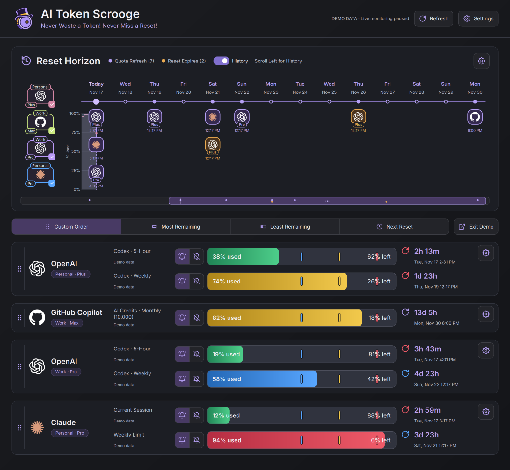

# AI Token Scrooge for macOS and Linux

A PyQt6 port of the Windows AI Token Scrooge app. It monitors the same providers, uses the same layout and dark palette, and follows the same credential rules. The Windows app in `src/` is unchanged; this folder is self-contained.



> Status: preview. The port's provider mapping, alerts, history, timeline geometry, settings and refresh orchestration are covered by fixture and offscreen tests. Live provider sign-in on macOS and Linux has not been verified yet. See [Verification Status](#verification-status).

## Requirements

- Python 3.11 or later
- PyQt6 (QtMultimedia is used for alert sounds when your distribution provides it)
- `keyring` with a real system keychain: Keychain on macOS, or GNOME Keyring / KWallet (Secret Service) on Linux. GitHub sign-ins are refused when only a plaintext or null backend is available.
- Optional: `PyQt6-WebEngine` for Devin Enterprise
- Provider tools, as on Windows:
  - OpenAI Codex: the `codex` CLI
  - Claude: Claude Code 2.1.310 or later (`claude`)
  - GitHub Copilot: no CLI needed (browser device sign-in)

## Run from Source

```sh
cd pyqt
python3 -m venv .venv
.venv/bin/pip install -e '.[devin,test]'
.venv/bin/token-scrooge            # or: .venv/bin/python -m token_scrooge
```

Useful options:

| Option | Purpose |
| --- | --- |
| `--demo` | Show built-in demo accounts and history; live monitoring is paused and nothing is saved |
| `--data-dir PATH` | Use an isolated data folder for this run (recommended for testing and screenshots); overrides `SCROOGE_DATA_DIR` |
| `--compact` | Open at a compact window size |
| `--background` | Start hidden in the system tray or menu bar |

Environment variables:

| Variable | Purpose |
| --- | --- |
| `SCROOGE_DATA_DIR` | Use this folder instead of the platform default. Unlike `--data-dir`, it is treated as your normal location: launch at sign-in stays available and the sign-in entry names the folder explicitly |
| `SCROOGE_CODEX`, `SCROOGE_CLAUDE` | Path to a specific `codex` or `claude` executable. It must be owned by you or root and not writable by others |
| `XDG_DATA_HOME`, `XDG_CONFIG_HOME` | Standard Linux locations for the default data folder and the autostart entry |
| `TZ` | Used for the System Time Zone choice, before `/etc/localtime` |

Provider credential variables such as `ANTHROPIC_API_KEY`, `OPENAI_API_KEY`, `GITHUB_TOKEN` and `GH_TOKEN` are not used. Scrooge monitors subscription sign-ins, and it removes `ANTHROPIC_*`, `CLAUDE_*`, `OPENAI_*`, `CODEX_*`, `GITHUB_*`, `GH_*` and similar variables from the environment of the CLIs it starts, so a personal API key or config in your shell cannot change which account an isolated profile reads.

Run the tests with `.venv/bin/python -m pytest -q` from `pyqt/`. Qt tests use the offscreen platform.

## Layout

| Folder | Contents |
| --- | --- |
| `token_scrooge/core` | Domain model, settings, alert evaluation, labels and time zones (no I/O) |
| `token_scrooge/infra` | SQLite store, keychain secrets, bounded CLI runner, Codex/Claude/GitHub/Devin clients, account monitor |
| `token_scrooge/app` | Qt presentation: dashboard, Reset Horizon, settings, connect flows, tray, notifications, sounds |
| `token_scrooge/app/presentation.py` | Qt-free view models and timeline geometry, shared by widgets and tests |

## Where Data Lives

| Platform | Data folder |
| --- | --- |
| Any (override) | `$SCROOGE_DATA_DIR`, or `--data-dir` for one run |
| Linux | `$XDG_DATA_HOME/ai-token-scrooge` (usually `~/.local/share/ai-token-scrooge`) |
| macOS | `~/Library/Application Support/AI Token Scrooge` |

The folder is created with owner-only permissions. Isolated provider profiles live under `Security/<id>/` in the platform default folder, keyed by the chosen data folder's identity, with `Profiles`, `ClaudeProfiles` and `DevinProfiles`. The SQLite database (`radar.db`, mode 0600) holds accounts, snapshots, history and alert records, never credentials or raw provider responses. GitHub tokens are kept in the system keychain.

## Differences from the Windows App

| Area | Mac/Linux port |
| --- | --- |
| Credential storage | System keychain via `keyring` instead of DPAPI; Codex uses its own keyring store as on Windows |
| Devin | QtWebEngine with one persistent profile per connection instead of WebView2. HTTP 403/429 status detection is not available; failures fall back to page-content checks |
| Notifications | `QSystemTrayIcon` messages, without Snooze/Dismiss buttons inside the OS notification. The in-app banner keeps all three actions |
| Launch at sign-in | `~/.config/autostart/ai-token-scrooge.desktop` on Linux, a LaunchAgent plist on macOS. Never written for `--demo` or `--data-dir` runs; includes `--data-dir` when `SCROOGE_DATA_DIR` chose the folder |
| App updates | Not available yet; the settings card shows the version only |
| CLI discovery | Known install folders first, then `PATH` resolved to an absolute, owner-controlled, non-world-writable file. `SCROOGE_CODEX` and `SCROOGE_CLAUDE` override the path |

## Verification Status

| Evidence | Status |
| --- | --- |
| Fixture tests | Provider mapping, Claude/Devin parsers, alerts, reminders, quiet hours, history runs, sign-in journal, GitHub renewal, refresh orchestration |
| Offscreen rendering | Dashboard (wide and compact), Reset Horizon, settings and account settings compared with `conversion-for-mac/images` |
| Native desktop | Run in demo mode with an isolated data folder on Linux (Wayland/X11). Not yet checked on macOS |
| Live providers | Not yet verified on macOS or Linux |
