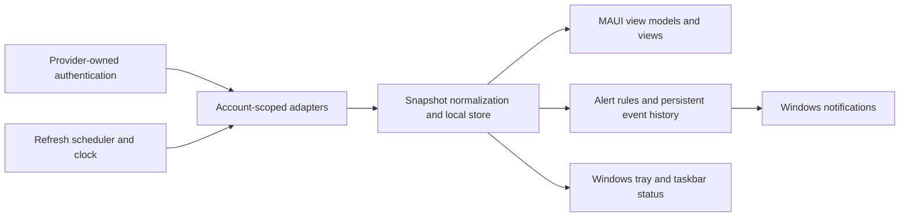

# AI Reset Radar — Windows implementation plan

Current feature plan (October 29, 2026): [Unified Reset Horizon History](history-plan.md), with [task cards](history-todo.md). It uses one Weekly history series per OpenAI/Claude account and one Monthly series per Copilot account. The original project plan below is preserved as historical implementation context; the feature plan and current user decisions govern this addition.

Planning date: October 25, 2026. Status: implementation in progress under the active build goal. The final visual target is selected: round 2 image 7, Quiet Warning, with tall bars containing Used/Left text, no duplicate numeric column, and amber warning states. The exact user-selected screenshot is `D:/Dev/AI/AIResetRadar/design/references/approved-ui.png`. See `../design/selection.md`. This document and `todo.md` remain the execution contract; current evidence and required open gates are recorded in `../docs/verification.md`.

## Product outcome

A beautiful, dark-only Windows .NET MAUI app that answers: **How much AI capacity do I have left, when does it return, and do I have earned resets that will expire?** It monitors several accounts from the same provider as well as different providers. It stays available in the Windows tray and alerts the user about low capacity, restored capacity, and expiring reset credits.

OpenAI initially means **Codex subscription usage**, with the product identity shown explicitly. General ChatGPT model quotas and OpenAI API billing are distinct integrations and are outside the initial release unless separately verified and added. Other providers can be added through the same adapter contract; they are not promised working integrations in version one.

## Initial scope and completion bar

- Windows 11, x64 first; native MAUI XAML with WinUI 3 platform integration. Use supported .NET 10 / MAUI 10 versions pinned after a prerequisite check. Keep portable domain logic separate from Windows code; other operating systems are future work.
- Multiple independently connected OpenAI and GitHub accounts, nicknames such as Personal / Work, and explicit workspace or billing-owner identity. Two accounts from one provider must coexist without switching the user's active IDE or Codex login.
- Used and remaining amounts or percentages for every exposed quota window, the exact next reset time, a local countdown, and the last successful refresh.
- A separate earned-reset reserve with available count, each known expiry, and earliest expiry. An unavailable field stays unavailable.
- Dashboard, account detail, account connection flow, reset reserve, tray quick view, notification history, and concise settings. The chosen concept determines the layout rather than every concept becoming a separate screen.
- Windows tray residency, optional launch at sign-in, state-changing tray icon, taskbar status overlay while the main window is open, and native Windows notifications.
- Local settings/history, protected credentials, offline/stale states, and a reproducible Windows package. No server or cloud sync is required.

Monitoring only: no automatic reset redemption, top-ups, subscription changes, emails, or account switching in other applications. A future explicit redemption feature would need its own design and authorization flow.

## Evidence and feasibility

### Creator Micro design reference

Inspected the actual local files and both saved screenshots:

- `D:/Dev/AI/CreatorMicroModelKeys/Editor/MainPage.xaml`
- `D:/Dev/AI/CreatorMicroModelKeys/Editor/App.xaml`
- `D:/Dev/AI/CreatorMicroModelKeys/Editor/CreatorMicroEditor.csproj`
- `D:/Dev/AI/CreatorMicroModelKeys/docs/media/editor.png`
- `D:/Dev/AI/CreatorMicroModelKeys/docs/media/settings.png`

The editor already uses MAUI on .NET 10 Windows. Reuse its visual vocabulary: charcoal gradient `#1B1C20` → `#141519`, graphite panels `#222329`, input surfaces `#2A2B30`, understated borders `#3B3D47`, lavender icons `#B5A0F4`, purple primary controls around `#7169CA`, white text and muted gray labels. Use Segoe UI / Semibold, Segoe Fluent Icons, roughly 8–12 px control corners and 18 px panel corners. Retain the quiet header, Refresh / Settings treatment, spacing, and depth. Adapt its patterns into reusable MAUI resources rather than copying its absolute keypad positioning or event-handler architecture.

Copied reference screenshots into `design/references/`; eight independent mockups are in `design/concepts/`. See `design/concepts.md` and the exact generation prompts in `design/concepts/prompts.json`.

### Provider capability matrix

| Integration | Verified interface | What it can establish | What must be proven during implementation |
| --- | --- | --- | --- |
| OpenAI Codex | Local `codex app-server` protocol | `account/rateLimits/read` exposes usage windows; the multi-bucket form is preferred. Earned reset count/details may also be present. | Installed-version schemas, real-account availability, identity/workspace matching, safe independent logins and refresh behavior. |
| GitHub Copilot personal billing | REST billing usage endpoints, including `/users/{username}/settings/billing/ai_credit/usage` and the legacy premium-request counterpart | Period usage; fine-grained personal tokens support Plan read permission. | Correct quota/allowance denominator, credits versus requests, discounts/included usage versus paid overage, latency, and real-account reconciliation. |
| GitHub organization/enterprise funded Copilot | Corresponding authorized billing-owner endpoints | Usage billed to that owner, subject to permissions. | Whether the user can access it and whether individual allowance attribution is actually possible; an organization total is never presented as personal remaining capacity. |
| General ChatGPT model limits | No suitable general monitoring interface verified in this planning pass | Nothing promised. | Separate research required. |
| OpenAI API or another provider | Deferred adapter | Architecture extension point only. | Authentication, usage source, quota definitions and reset semantics must be researched first. |

The Codex protocol documents `usedPercent`, `windowDurationMins`, `resetsAt` in Unix seconds, and `rateLimitsByLimitId`. Earned resets have an authoritative available count; details can be null or capped, and expiry can be null. These fields describe Codex service limits, not every ChatGPT feature. Source: [Codex app-server](https://learn.chatgpt.com/docs/app-server).

GitHub billing-owner endpoints differ from personal ones. A usage report alone does not establish a complete live quota. Source: [GitHub billing usage REST API](https://docs.github.com/en/rest/billing/usage). Current included AI credits reset on the first of the calendar month at 00:00 UTC and do not carry over; that differs from the subscription invoice date. Source: [Copilot individual billing](https://docs.github.com/en/copilot/concepts/billing-and-usage/individuals/billing). Keep legacy premium-request accounts supported where applicable rather than hardcoding one current plan table.

### Can the taskbar icon change?

Yes, with distinct Windows surfaces:

| Surface | Planned behavior | Mechanism / limit |
| --- | --- | --- |
| Tray / notification-area icon | Persistent monitor indicator while Radar is running; change state or a coarse capacity ring, update tooltip, open quick view. | `Shell_NotifyIcon` add/modify/remove. Windows controls whether it is visible or in overflow. |
| Running app's taskbar button | Stable radar brand plus healthy / low / exhausted / attention overlay. | `ITaskbarList3.SetOverlayIcon`; state changes, not animation. Windows grouping and taskbar settings affect presentation. |
| Window icon | May change for explicit application states if useful after the spike. | `AppWindow.SetIcon`; verify behavior with the chosen package. |
| Pinned shortcut when app is closed | Stable application branding. | Do not promise a live icon for a stopped process or continually rewrite shortcut assets. |

Prefer a recognizable radar icon with small discrete state changes. Start with tray plus taskbar overlay; continuous animation and an optional taskbar progress meter are outside the first release. Status is derived from monitored windows, not an average across providers. Default scope is all enabled accounts; the tooltip identifies the limiting account/window and any stale sources. A user may pin a specific window later in settings. Unknown/stale data must not produce an all-healthy claim.

Sources: [Tray API](https://learn.microsoft.com/en-us/windows/win32/api/shellapi/nf-shellapi-shell_notifyiconw), [taskbar overlays](https://learn.microsoft.com/en-us/windows/win32/api/shobjidl_core/nf-shobjidl_core-itaskbarlist3-setoverlayicon), [window icon](https://learn.microsoft.com/en-us/windows/windows-app-sdk/api/winrt/microsoft.ui.windowing.appwindow.seticon?view=windows-app-sdk-1.8).

## Usage and reset rules

1. Identify data by provider + authenticated subject + workspace/billing owner + quota bucket. Nicknames are presentation, not identity. Detect duplicate connections for the same scope without merging different workspaces.
2. Every window has its own unit: percent, requests, AI credits, tokens, currency budget, or provider-defined. Never sum or average incompatible allowances.
3. For an authoritative percentage, display `left = clamp(100 - usedPercent, 0, 100)`. Preserve raw values for diagnostics; malformed negative/invalid values produce unavailable data rather than invented capacity. Over-limit amounts remain visible even when a visual bar is capped.
4. Calculate absolute remaining only when usage and the allowance are known, compatible and from the same period/scope. Record allowance provenance: provider-reported, verified plan metadata, or user-entered. Label manual and estimated values. Unknown denominators show usage with “Limit unavailable,” not a percentage ring.
5. A headline account figure must name its selected window. An optional “limiting window” is the minimum known comparable capacity within that account, explicitly labeled; never silently choose a flattering short window while a weekly window is exhausted.
6. Store timestamps in UTC with `DateTimeOffset`. Format in the user's current local zone; show timezone/offset and exact timestamp in details. Countdown calculations use an injected clock; no timestamp math in UI code.
7. At a quota reset boundary, mark “Reset due — checking” and refetch. Do not zero observed usage or declare restored capacity just because the timer elapsed. Confirm a new period/reset timestamp or provider evidence. Suppress repeated due requests with bounded retries.
8. Model earned reset credits separately from normal allowance cycles and purchased balance. Preserve authoritative count independently of any returned detail rows. Distinguish no credits, unknown count, unknown details, unknown expiry, expired, and partially listed details. Do not infer expiry from grant date or count.
9. Refresh earned reset status at expiry. Until confirmed, remove a passed-expiry item from the locally usable set but label the reported count as last seen; avoid silently fabricating a new server count.
10. Display last successful fetch and, where available, the provider's data-as-of time. New HTTP retrieval does not guarantee real-time billing data. Preserve the last good snapshot on errors, visibly stale.

## Interaction design

The dashboard should let the user choose a provider/account, read each quota window's Used / Left / Reset, see the next event and earned-reset expiry, and open details. Account rows support source health and reconnect. A dedicated reset section exposes the reserve without confusing it with monthly credits. Account settings allow rename, disable monitoring and remove local connection.

The add-account flow explains what source can be read, opens provider-owned sign-in or provides a protected token entry, resolves the actual account identity, and previews the observed capabilities. Never ask for provider passwords. The user selected browser sign-in for GitHub on October 25: GitHub App device authorization with Plan read permission is the personal-billing default, with protected credential renewal. Fine-grained tokens remain an advanced path, including organization billing; a generic OAuth scope is not assumed to grant billing access. See `../docs/github-sign-in.md` for registration and credential boundaries. An account with insufficient permission remains visible with an actionable explanation and provider usage-page link. A manual allowance can supplement verified usage; a manual-only source is labeled as such.

UI states: first launch / no accounts, connecting, loading with prior values, healthy, low, exhausted, reset due, expiry soon, offline, stale, authentication required, insufficient permission, unsupported field, and partial source data. Use words/icons as well as color. Main views reflow from approximately 1440×1024 to 800×700 logical pixels; the tray flyout is approximately 420–480 logical pixels wide. Allow scrolling rather than clipping. Support keyboard navigation, visible focus, Narrator labels and 100/150/200% display scaling. Dark-only applies to app-owned surfaces; native Windows notification appearance follows Windows settings.

If the selected concept uses tables, standardize search, clear, loading, empty state, row formatting and pagination once. For a small account list, avoid unnecessary paging. Tabs use the source's segmented-control styling where appropriate. Do not add all eight concepts as selectable themes.

## Notification behavior

- Native Windows app notifications for background use; matching in-app banners and a persistent local event history. App-owned banners use the chosen dark theme. Windows owns the toast frame.
- Default low-capacity thresholds: 30%, 10%, and exhausted, configurable per account/window. Notify only on crossing a threshold; starting with an already-low account may create one informational event. If several thresholds are crossed between polls, emit the most severe event once.
- Notify when an exhausted window is confirmed usable again. A known future reset can yield an optional “reset time reached” reminder, worded as a reminder until refreshed.
- Default earned-reset expiry reminders at 24 hours and 1 hour; optional earlier reminders. Only schedule when a real expiry is known. Reconcile reminders whenever the provider's credit list/status changes.
- Actions: View account, Snooze 1 hour, Dismiss. View navigates to the exact provider/account/window even after cold launch. Snooze affects alerts, not collection.
- Quiet hours, optional sound, notification test, privacy mode hiding account identities, per-rule enable/disable and OS-disabled-notifications explanation.
- Persist event keys and snooze state to prevent repeated alerts across polls/restarts. Window keys include the provider period; credit events include opaque credit ID, expiry and threshold. Deduplicate in-app and native channels as one logical event.

Use Windows App SDK `AppNotificationManager` for delivery and activation, including single-instance routing. Sources: [notifications overview](https://learn.microsoft.com/en-us/windows/apps/develop/notifications/) and [quickstart](https://learn.microsoft.com/en-us/windows/apps/develop/notifications/app-notifications/app-notifications-quickstart). Known-time scheduled reminders are optional after package verification; Windows can drop scheduled delivery after the machine is off beyond its delivery window. Reconcile on resume instead of promising guaranteed delivery while powered off. Source: [scheduled notifications](https://learn.microsoft.com/en-us/windows/apps/develop/notifications/app-notifications/app-notifications-scheduled).

## Architecture

Suggested projects:

- `src/AIResetRadar.App`: MAUI app, resources, views/view models, composition, Windows-specific tray/window/notification code under `Platforms/Windows`.
- `src/AIResetRadar.Core`: account identity, capabilities, quota/reset models, calculations, scheduler decisions, alert rules. No MAUI dependency.
- `src/AIResetRadar.Infrastructure`: provider clients, local persistence, protected-secret abstraction and process transport.
- `tests/AIResetRadar.Core.Tests` and `tests/AIResetRadar.Infrastructure.Tests`: deterministic rules and fixture-based adapter contracts.

Use MVVM, dependency injection and typed `HttpClient`s. Start with framework facilities; add maintained packages only where they save clear complexity. SQLite stores non-secret account metadata, snapshots, settings, alert history, scheduled-reminder references and schema version. Keep a bounded 30-day history by default and no prompt or conversation content.

Core records include `ProviderAccount`, `ProviderCapabilities`, `QuotaSnapshot`, `QuotaWindow`, `ResetReserve`, `ResetCredit`, `AllowanceProvenance`, `SourceHealth`, `AlertRule` and `AlertEvent`. Every snapshot includes subject/scope, observation time, provider data time if known and schema version. Nullable values and unsupported capabilities are first-class. Capability flags describe actual adapter/account evidence rather than provider-wide assumptions.

`IUsageProvider` exposes account connection/identity resolution, capability discovery, read-only refresh, and disconnect. Secret storage is a separate interface. Windows integration uses `ITrayService`, `ITaskbarStatusService`, `INotificationService`, `IStartupService`; rules depend on `TimeProvider`. Refresh results are immutable and dispatched onto the MAUI UI thread.

### Authentication and account isolation

Store app-owned tokens using Windows Credential Manager or current-user DPAPI behind a tested credential abstraction. Never log tokens, auth JSON, headers or raw provider responses containing identity secrets. Do not persist tokens in SQLite or export them with settings.

Codex integration uses a dedicated child process and explicit allowlist of protocol operations for identity/login and read-only limits. Do not load the user's project config, tools or MCP integrations for monitoring; launch with a minimal app-owned profile. Authenticate each account separately and verify the returned subject and workspace on every refresh. Prefer OS-protected credential storage, failing visibly rather than silently falling back to plaintext. Account-specific `CODEX_HOME` is a proposed isolation mechanism, not proof that all credential backends are isolated; verify the exact installed version and keyring namespace. Never rotate, overwrite or delete the user's existing `.codex/auth.json` or shared credentials. Refresh-token ownership must have one clear writer.

Credential modes and shared CLI/extension login behavior are documented in [Codex authentication](https://learn.chatgpt.com/docs/auth). Multi-account storage and refresh remain an early spike, with no sign-in changes during this planning pass. If safe isolation is unavailable, stop that connection path and report the specific blocker rather than pretending two nicknames mean two authenticated accounts.

### Collection and background lifetime

One single-instance desktop process owns refresh scheduling, local storage and tray lifetime. Closing the window defaults to hiding it with a first-use explanation; Exit explicitly ends monitoring. Launch at sign-in is opt-in. Handle power resume, network restoration, date/time changes, Explorer restart, display/DPI changes and normal shutdown. Do not install a Windows service for v1.

Initial polling defaults to tune in the spike: Codex every 60 seconds while viewed / 120 seconds in tray; GitHub billing every 5 minutes. Provider updates can trigger targeted refreshes where supported. Local countdowns do not require network polling. Deduplicate requests, enforce per-account timeouts, honor Retry-After, use jittered exponential backoff, and bound concurrency to two. Manage owned Codex child processes with an idle limit and memory measurement; do not accumulate one uncontrolled process per account. Stale status starts after three expected refresh intervals, with provider data-latency notes retained separately.

## Ordered execution phases

Detailed task cards, acceptance and verification are in `todo.md`.

1. **Resolve the visual selection and prove integrations.** Confirm chosen image(s); record approved adaptations. Verify the installed toolchain, protocol schemas, provider access and two-account isolation. Prove native notifications/tray in the intended Windows package before investing in polish. Produce a support matrix with observed and unverified fields.
2. **Deliver a complete demo slice.** Models and time rules → local sample data → styled dashboard/account detail → earned reset reserve. Demo data is unmistakably labeled; no synthetic values are shown as live.
3. **Connect OpenAI Codex.** Supported sign-in, identity-bound snapshots, multiple windows, earned resets, offline/reconnect and simultaneous-account checks. Validate values against the provider UI.
4. **Connect GitHub Copilot.** Personal billing source, correct units/period, allowance provenance, legacy requests when applicable, explicit permissions and organization boundaries. Validate against the account billing UI or export, noting latency.
5. **Complete background workflows.** Persistence, scheduler, tray quick view, lifecycle, taskbar state and notifications with deduplication, quiet hours, snooze and activation.
6. **Polish and package.** Native UI visual comparison, scaling/accessibility, failure recovery, bounded resource use, release packaging and fresh-user install checks. Finish docs with real capability coverage and remaining limitations.

Checkpoints after each phase: targeted tests/build pass and the slice works in the native app; record evidence before proceeding. Review findings can refine implementation within the approved scope without repeated permission requests. New product scope needs a separate decision.

## Verification and release acceptance

- Meaningful domain tests cover multiple windows, percent math, unknown amounts, overage, null reserve/detail/expiry, partial lists, true zero versus unavailable, timestamps in seconds, DST/month/year boundaries, reset confirmation, threshold crossings, snooze/quiet hours and restart deduplication.
- Adapter fixtures cover current and older Codex shapes, unknown buckets, malformed data, auth mismatch, workspace change, HTTP 401/403/429/5xx, GitHub units/discounts, missing allowance and permission failures. Redact fixtures before committing.
- Live checks require two authorized accounts from at least one provider to prove same-provider isolation; both provider integrations require their own permitted account evidence. Missing credentials block those checks and must be reported, not replaced by demo success.
- Native UI comparison uses Creator Micro editor/settings and the selected concept at 1440×1024 and 800×700, plus 100/150/200% scaling. Use real native Windows app screenshots and interactions; MAUI is not a browser page. Use browser checks only for any actual web sign-in/help surfaces. Report reference paths and visible differences.
- Exercise add/rename/remove/reconnect, refresh, all quota and expiry states, tray hide/restore/Exit, startup opt-in, Explorer restart, notification actions while running and cold-started, OS notifications disabled, sleep/resume and clock/timezone changes. No duplicate instance, notification storm or leaked icon handles.
- Verify Release build and test projects, then publish a self-contained x64 package. Prefer MSIX for release; decide signing/distribution after the notification/startup spike. Keep an unpackaged developer build. Sign only with an approved certificate; no certificate purchase, trust-store changes or public release are implied.
- Measure idle memory, child-process count, refresh duration and network requests; record realistic baseline and any battery concerns. No fixed performance claim is made in this plan.
- No test may spend AI inference credits or redeem resets. Monitoring reads must never issue chat/completion requests just to obtain rate-limit headers.

## Risks, open choices and exclusions

| Risk / decision | Resolution |
| --- | --- |
| Different meanings of “OpenAI usage” | Initial adapter is explicitly Codex; general ChatGPT/API usage is deferred. |
| Copilot billing data lacks complete quota information | Show observed usage and source age; require verified or explicitly manual allowance before calculating left. |
| Organization usage cannot be attributed personally | Show scope honestly; require authorized owner data or expose unavailable fields. |
| Provider protocols evolve | Pin supported executable/API versions, use capability discovery and fixture tests; fail clearly on unknown required shapes. |
| Earned reset fields absent or partially returned | Null-aware UI, authoritative count and partial-details label; no fabricated expiry. |
| Shared authentication side effects | Early two-account/profile/credential refresh spike is a release gate. |
| Native notification/pinned icon assumptions | Verify actual packaged Windows behavior early; keep stable shortcut branding and a dependable tray path. |
| Visual direction | Selected: round 2 image 7, Quiet Warning; exact target is `design/references/approved-ui.png`. See `../design/selection.md`. |
| Distribution | Local x64 first; MSIX signing/channel to be settled before distribution. |

Deferred: macOS/mobile, cloud sync, general web scraping/browser-cookie access, undocumented private provider endpoints except the limited GitHub entitlement lookup below, automatic account switching, reset redemption, top-ups, predictive time-to-exhaustion, and additional providers beyond the extension contract. Monitoring permission does not authorize consuming an earned reset.

October 25 allowance refinement: following the user's request to discover total GitHub allowance automatically, Radar queries `api.github.com/copilot_internal/user` using its own identity-verified GitHub connection. This exception is limited to finite, unit-compatible personal-plan entitlement data; it does not permit browser-cookie access or borrowing credentials from another app. The endpoint is internal and may change. Manual/unknown fallback, scope checks and provenance remain required; see `../docs/github-sign-in.md` for live evidence and limitations.

## Planning-pass verification limits

The workspace was empty when inspected. Installed SDK list includes .NET 10; a MAUI SDK pack exists. `dotnet workload list` failed because the restricted process could not open the Windows Service Control Manager, so workload completeness is **not confirmed**. `codex --version` returned `0.164.0-alpha.11.1`; `codex app-server --help` is present and labels app-server experimental. The executable also reported inability to create/clean its temporary aliases under the current sandbox. No credentials, account sessions, network quota calls, project compilation or runtime monitoring were exercised. Creator Micro was inspected from source and saved screenshots, not launched. Eight images were generated and visually inspected; they are design studies with occasional numeric/time-label inconsistencies, not validated UI behavior.

Official platform references: [MAUI supported platforms](https://learn.microsoft.com/en-us/dotnet/maui/supported-platforms), [MAUI support policy](https://dotnet.microsoft.com/en-us/platform/support/policy/maui). Recheck versions and provider schemas at implementation time.
